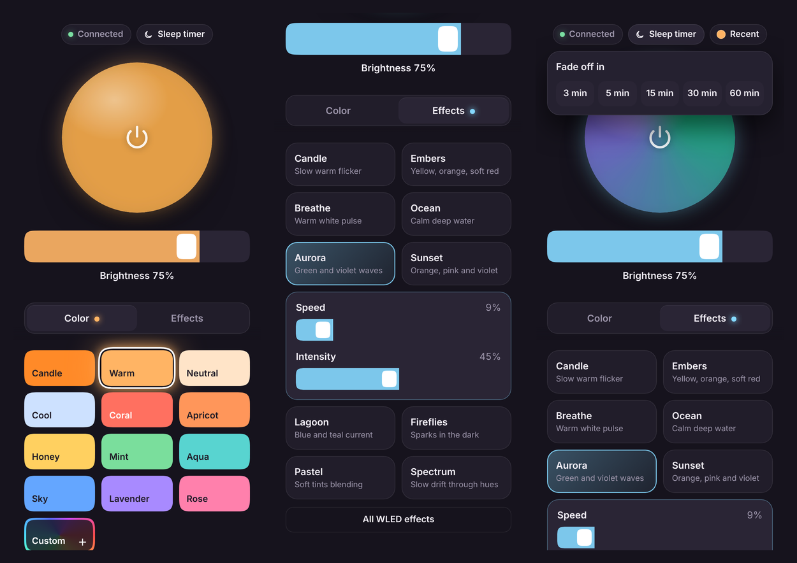

<p align="center"></p>

<h1 align="center">Lamp: a calm remote for the Intellect WLED lamp</h1>

<p align="center">A simple, good-looking replacement for the stock WLED interface.<br>It's a couple of small files that live inside the lamp itself and work on any phone or computer on your Wi‑Fi.</p>



## What it does

- **On/off**: tap the big orb. It shows the lamp's live colors in real time.
- **Brightness**: one large slider; tap or drag anywhere on it.
- **Colors**: 12 ready-made colors (warm whites plus soft tones), and a color wheel under **Custom** for saving your own.
- **Scenes**: 10 calm, pre-tuned animations made for a diffused lamp: Candle, Embers, Breathe, Ocean, Aurora, Sunset, Lagoon, Fireflies, Pastel and Spectrum. Each scene has its own speed and intensity sliders. The full list of WLED effects is still there under **All WLED effects**.
- **Sleep timer**: the lamp fades out over 3, 5, 15, 30 or 60 minutes, with a countdown at the top.
- **Recent**: one tap takes you back to the color or scene you had before.
- **Settings**: Wi‑Fi, a backup access point, schedules, Siri and more, in plain words (see [Settings](#settings)).
- **Home Screen app**: has its own icon and opens full screen, like a native app.

Nothing is sent to the internet. The app talks only to your lamp, over your home network. (Two exceptions, both downloads from this page: installing a [language](#languages), and a check for a new version once a day, which you can switch off in **Settings → Software**. Nothing about your lamp is sent.)

## What you need

- An **Intellect** lamp (or any lamp running **WLED**; the app was built and tested on WLED 0.14 with an ESP8266 and 87 LEDs, and also tested on WLED 0.13.3 with an ESP8266 and 88 LEDs).
- The lamp already set up and connected to your Wi‑Fi.
- A phone or computer on **the same Wi‑Fi network**.

## Install (about 2 minutes)

### 1. Download the files

On this page, click the green **Code** button → **Download ZIP**, then unzip it.
You only need the files in the **`dist`** folder:

- **`app.htm`** and **`icon.png`**: the remote (required);
- **`setup.htm`**: the new settings (recommended);
- **`index.htm`**: makes `http://LAMP-ADDRESS/` open the remote (optional; without it the stock WLED interface stays there).

### 2. Find your lamp's address

The lamp's address looks like `192.168.1.133`. You can find it:

- in the official **WLED** app: open the lamp, and the address is shown in the lamp's info or settings;
- or in your Wi‑Fi router's list of connected devices (it usually shows up as `WLED` or `INTELLECT`).

In the steps below, replace `LAMP-ADDRESS` with that address.

### 3. (Recommended) Back up the lamp's settings

Open `http://LAMP-ADDRESS/` in a browser → **Config** → **Security & Updates**, then click **Backup presets** and **Backup configuration**. You'll get two small files you can restore later from the same page.

### 4. Upload the app to the lamp

1. Open **`http://LAMP-ADDRESS/edit`** in a browser on your computer.
2. At the top, click **Choose file**, select **`app.htm`** from the `dist` folder, then click **Upload**.
3. Do the same for **`icon.png`** and **`setup.htm`** (and **`index.htm`**, if you want it).

The files now appear in the list on the left.

### 5. Open it

Open **`http://LAMP-ADDRESS/app.htm`**. You should see the orb and a green Wi‑Fi icon at the top.

Then tap the gear in the top right corner once. If it says **Your lamp can get locked out**, tap **Fix it** (see [If you change your Wi‑Fi](#if-you-change-your-wifi)).

### 6. Add it to your Home Screen

- **iPhone (Safari):** tap **Share** → **Add to Home Screen** → **Add**.
- **Android (Chrome):** tap **⋮** → **Add to Home screen**.

Now it opens like a regular app, with its own icon.

## Using it with several people

Anyone on the same Wi‑Fi can open `http://LAMP-ADDRESS/app.htm` on their own phone and add it to their Home Screen. You all control the same lamp and see the same state: on/off, brightness, color, scene and timer.

Saved custom colors, the **Recent** pill and the language are kept per device, in that phone's browser.

## Settings

Tap **Settings** at the top of the remote. Everyday things come first, in plain words:

- **Wi‑Fi** and the **Backup access point** (see below);
- **Lamp**: language, name, what it does when it gets power, fades and sleep timer, scenes that switch on by the clock (**Time & schedule**), power limit;
- **Care**: download and restore the lamp's settings and scenes, software version, restart and updates;
- **Advanced**, for tinkerers: LEDs & wiring, sync with other lamps, **Smart home** (ready-made Siri Shortcuts addresses for on/off, brightness, your colors and scenes, plus Alexa, Philips Hue and MQTT), light shows and security.

Changes are saved to the lamp itself, the same settings the stock WLED pages edit. The stock pages stay at `http://LAMP-ADDRESS/settings` if you ever need them.

## If you change your Wi‑Fi

If the router's name or password changes, the lamp can no longer join it. Instead, about 12 seconds later, it opens its own small Wi‑Fi network, the **backup access point**, usually called **INTELLECT**:

1. On your phone, join the **INTELLECT** network.
2. The settings open by themselves (if they don't, open **`http://4.3.2.1/setup.htm`**).
3. Enter the new Wi‑Fi name and password. The lamp restarts and joins it.

This needs **Settings → Backup access point** set to **Whenever Wi‑Fi is lost**. Many lamps ship with *Only right after power‑on*; the settings page warns you and fixes it in one tap. While it's open, anyone nearby can join the access point, so we recommend setting an **access point password** on the same page.

## Languages

The remote itself stays in English. The settings page can be switched to **Russian** or **Ukrainian** from **Settings → Language**: the phone downloads the file from this page and saves it on the lamp, so it needs to be online once (for example, on mobile data or your home Wi‑Fi). After that, every phone on the lamp can use it, and each phone picks its own language.

## Updating

**From the phone:** open **Settings → Software** and tap **Check for updates**, then **Update**. The phone downloads the new files from this page, saves them on the lamp one by one, checks each one, and reloads. Keep the page open until it's done. If something fails, don't close the page: tap **Try again**. Installed languages are updated too.

The remote and the settings also look for a new version on their own, once a day and quietly, a few seconds after they open: a small dot appears on **Settings** and an **Update available** banner at the top of the settings. They only download a small `version.json` from this page; nothing about your lamp is sent. You can switch this off in **Settings → Software**.

**By hand:** download the new files and upload `app.htm` (and `setup.htm`, if you use the settings) from the `dist` folder through `http://LAMP-ADDRESS/edit` again. They replace the old ones. If you already have the remote, re-uploading `app.htm` is enough; without `setup.htm`, the gear opens the stock WLED settings. If the icon changed too, upload the new `icon.png`, then remove the Home Screen shortcut and add it again (phones cache the icon).

### Or in one command

On a computer with Python, on the same Wi‑Fi as the lamp, in the downloaded (or pulled) folder:

```
python3 tools/upload.py LAMP-ADDRESS
```

It uploads `setup.htm`, `app.htm` and `icon.png` from `dist` (and `index.htm`, if the lamp already has one), reads each file back to check it, and prints one line per file. Running it again is always safe. To add `index.htm` for the first time, add `--with-index`; to delete it, `--remove-index`.

### With an AI coding agent

A change merged on GitHub doesn't reach any lamp by itself: every lamp owner uploads the new files once, the same way they installed them. If you ask an AI coding agent to "update the lamp following the README", these are the steps for it:

1. In the clone of this repository, `git pull` the latest `main` from `github.com/VadimKalinin1993/intellect-lamp-remote` (or clone it if there's no clone yet). If the clone has local changes, stop and ask the owner what to do with them.
2. Run `python3 tools/upload.py <lamp address>`. If the owner didn't give the address, ask for it (it looks like `192.168.1.133`; it's in the router's list of connected devices, usually as `WLED` or `INTELLECT`, and in the WLED app). Don't guess or scan the network.
3. Check that every file line says **uploaded and verified** and the last line is **Done: every file verified.**
4. Tell the owner to open `http://<lamp address>/app.htm` and reload the page (on a Home Screen app: close it and open it again).

If something failed, run the same command again: it's safe to repeat. If the remote page is broken after a failed run, `setup.htm` is uploaded first, so `http://<lamp address>/setup.htm` still opens. If the script says the files won't fit, tell the owner instead of using `--force`.

After this, updates come straight from the phone: **Settings → Software → Update** (see [Updating](#updating)).

## Removing

Open `http://LAMP-ADDRESS/edit`, right-click `app.htm` (and `icon.png`, `setup.htm`, `index.htm`, `lang-*.json.gz`) in the file list, and choose **Delete**. The lamp is back to exactly how it was, except for any settings you changed, which stay as if you'd changed them on the stock pages. The stock WLED interface at `http://LAMP-ADDRESS/` is never changed (unless you uploaded the optional `index.htm`), so you can use it at any time.

## Troubleshooting

**The Wi‑Fi icon at the top is red and crossed out.** The app is offline. Check that the lamp is plugged in and that your phone is on the same Wi‑Fi network (not mobile data or a guest network).

**It worked yesterday, but today the page doesn't open.** Your router probably gave the lamp a new address. Find the new one (step 2) and add the shortcut again. To stop this from happening, reserve the lamp's address in your router settings (often called *DHCP reservation* or *static lease*). If you changed your Wi‑Fi, see [If you change your Wi‑Fi](#if-you-change-your-wifi).

**Settings opens the stock WLED settings.** `setup.htm` isn't on the lamp. Upload it from the `dist` folder (step 4).

**The app doesn't work outside home.** That's expected: it only works on your home network. WLED has no password protection for control, so don't expose the lamp to the internet. If you need remote access, use a VPN such as Tailscale.

**A scene looks different from what I expected.** LEDs behind a diffuser mix colors a bit differently from a screen. Use the scene's speed and intensity sliders to adjust it.

## For developers

- `app.htm` and `setup.htm` in the repository root are the readable sources; edit those. Each still works on its own if uploaded, but together they're too big for the lamp.
- `python3 tools/build.py` writes `dist/`: the same pages minified and gzipped into compact single files (needs Node for `npx terser`; the version is pinned in `build.py`, so the same sources give the same files). It also rebuilds `lang/lang-*.json.gz`.
- Translations live in `tools/translations.py`; `python3 tools/make_lang.py` writes `lang/*.json` and reports phrases that no longer exist in the pages. Then run `build.py`.
- Open `setup.htm?demo` from a local web server (for example `python3 -m http.server` in the repository root) to try the settings with the demo data in `dev/`, without a lamp.
- `python3 tools/upload.py LAMP-ADDRESS` uploads `dist/` to a lamp and verifies every file.
- `build.py` also stamps a version (a short hash of the sources plus the build date) into both pages and writes `dist/version.json`, which **Settings → Software** reads from GitHub to offer updates. To try an update on a lamp without GitHub, run `python3 tools/serve_dist.py --test` (it serves a build that differs only in its version, with CORS) and open the printed `http://LAMP-ADDRESS/setup.htm?updsrc=…` address and confirm; `?updsrc=` goes back to GitHub. For safety, updates are only accepted from this repository or from an address on the home network, and `?host=` works only on a page opened from a file or a local server.

## Files

| File | What it is |
|---|---|
| `dist/app.htm` | The remote, ready to upload: one self-contained page. |
| `dist/setup.htm` | The settings, ready to upload: one self-contained page. |
| `dist/icon.png` | The Home Screen icon. |
| `dist/index.htm` | Optional: makes `http://LAMP-ADDRESS/` open the remote. |
| `dist/version.json` | The current version, for the update check. Not uploaded to the lamp. |
| `app.htm`, `setup.htm`, `icon.png` | Readable sources of the files in `dist`. |
| `lang/` | Russian and Ukrainian translations; Settings → Language downloads them from here. |
| `tools/` | Build, translation and upload scripts (see [For developers](#for-developers)). |
| `dev/` | Demo data for trying the settings without a lamp (`setup.htm?demo`). |
| `screenshots/` | Images for this page; you don't need to upload them. |
